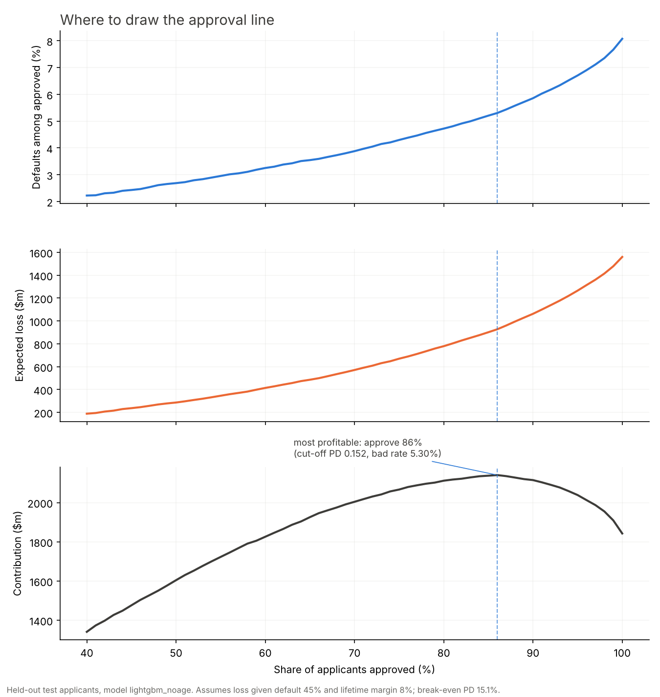

# Loan Default Risk & Approval Tool

**[Live app](https://loan-default-risk.streamlit.app)** · [Code](https://github.com/OkeyaDavid/loan-default-risk) · Python · scikit-learn · LightGBM · SHAP · Streamlit

Predicts the probability that a loan applicant defaults, explains every decision in plain
English, and shows a lender what each approval policy costs.



## The question

A lender cannot approve everyone and cannot decline everyone. Given 307,511
past applications, how well can we rank applicants by risk, and what does each approval
policy actually cost?

## Results

- **Ranking quality:** ROC-AUC **0.767** on 76,878 held-out applicants
  (cross-validated 0.760 ± 0.001, so no sign of overfitting).
- **The cut-off is worth more than the model.** Approving the safest
  **86%** of applicants instead of everyone holds defaults among
  approved loans to **5.30%** against
  8.07%, and avoids **$632.8m** of expected loss on
  the test set.
- **Dropping a protected attribute was nearly free, so it was dropped.** Removing age costs
  **0.0019 ROC-AUC** and about
  $4.4m of contribution on a
  $2.14bn book — around
  0.2% — so the shipped model uses
  neither age nor gender.
- **Probabilities are calibrated.** Worst gap between predicted and observed default rates
  across ten risk deciles: **0.004**. That is what makes the dollar
  figures meaningful.

### What drives the score

1. average external credit score
2. repayment term
3. external credit score 3
4. loan relative to the price of the purchase
5. years in current employment

(Mean absolute SHAP value; see `docs/shap_summary.png` and `docs/example_reasons.md`.)

## The approval policy

Loss given default 45%, lifetime margin 8%, so a marginal applicant is worth
approving up to a default probability of **15.1%**. Both numbers are stated
assumptions, not measurements, and they are the first thing to change in `src/config.py`.

| Approve | Cut-off PD | Defaults among approved | Expected loss | Contribution |
|---|---|---|---|---|
| 60% | 0.067 | 3.25% | $414.4m | $1,825.9m |
| 70% | 0.088 | 3.88% | $571.2m | $2,004.0m |
| 80% | 0.121 | 4.72% | $779.5m | $2,111.6m |
| 90% | 0.183 | 5.86% | $1,062.6m | $2,114.7m |
| 95% | 0.250 | 6.70% | $1,265.6m | $2,038.4m |
| 100% | 0.705 | 8.07% | $1,560.3m | $1,842.6m |

Losses use realised outcomes on applicants the model never saw, not its own predictions.

## Model comparison

| Variant | ROC-AUC | PR-AUC | Brier | CV ROC-AUC |
|---|---|---|---|---|
| `logistic_age` | 0.7452 | 0.2294 | 0.06853 | 0.7417 ± 0.0024 |
| `lightgbm_age` | 0.7693 | 0.2572 | 0.06714 | 0.7626 ± 0.0015 |
| `lightgbm_noage` | 0.7674 | 0.2528 | 0.06731 | 0.7604 ± 0.0009 |

**Shipped:** `lightgbm_noage`. LightGBM beats the logistic baseline by
+0.0241 ROC-AUC.

**No resampling and no class weights.** With an 8% default rate the temptation is SMOTE or
`class_weight='balanced'`; both distort predicted probabilities, which would make the
expected-loss figures above meaningless. The imbalance is handled where it belongs: in the
choice of threshold.

## Responsible lending

- **`CODE_GENDER` excluded from every variant.** Sex is a prohibited ground under the
  Canadian Human Rights Act and under US ECOA / Regulation B.
- **Age excluded too, on evidence.** Age is also protected and is genuinely predictive, so
  both variants were trained before deciding. Keeping it would have bought
  0.0019 ROC-AUC. That is not worth using a protected attribute in
  a lending decision, so the shipped model is `lightgbm_noage`. The age variant stays in
  `train.py` as the evidence.
- **Per-applicant reasons.** SHAP turns one score into the three factors that raised the risk
  and the three that lowered it — the shape an adverse-action notice needs.

## Data

[Home Credit Default Risk](https://www.kaggle.com/competitions/home-credit-default-risk/data),
`application_train.csv` only: ~307k applications, about 8% of which hit payment difficulties.
The other eight tables are deliberately out of scope; published scores that use them run
higher, around 0.79 ROC-AUC. The raw file is not committed (Kaggle terms, and it is 158 MB).

## Run it

```bash
git clone https://github.com/OkeyaDavid/loan-default-risk.git && cd loan-default-risk
python3 -m venv .venv && source .venv/bin/activate
pip install -r requirements.txt
# place application_train.csv in data/raw/
PYTHONPATH=src python src/features.py     # build the modelling table
PYTHONPATH=src python src/train.py        # three variants, ~10 min on a laptop
PYTHONPATH=src python src/cutoff.py       # policy sweep and chart
PYTHONPATH=src python src/explain.py      # SHAP summary and worked examples
PYTHONPATH=src python src/make_readme.py  # regenerate this file from the artifacts
streamlit run app.py
```

## Limitations

- One lender, one country, one definition of default ("payment difficulties").
- Loss given default and margin are assumptions; the optimal policy moves with them.
- No proxy test yet: excluding gender does not prove the remaining features carry no signal
  about it.
- The app scores one applicant at a time; it is a demonstration of the decision, not a
  production scoring service.

---
Built by David Okeya · [LinkedIn](https://www.linkedin.com/in/okeyadavid)
